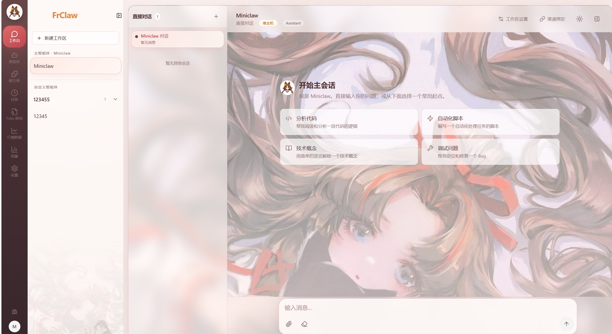
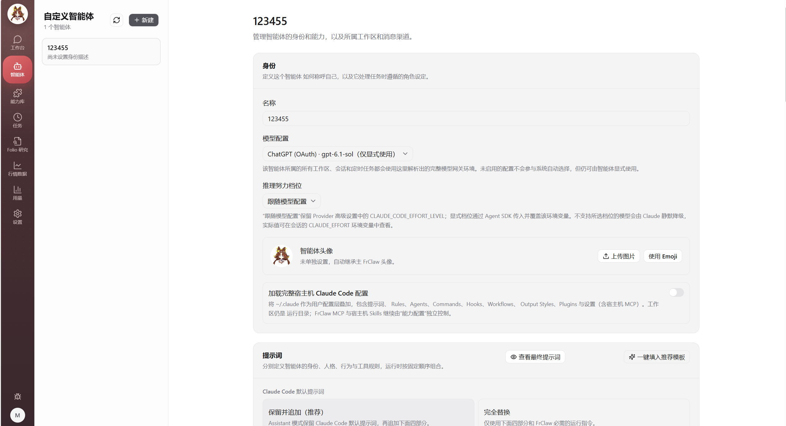

# FrClaw

  

  <strong>自托管、Pi Agent 驱动的智能体工作台</strong> 
  将 Agent、Workspace、模型、记忆、工具、消息渠道和自动化任务放进一个可配置、可审计的运行环境。

  <a href="https://github.com/Muiesya/frclaw">GitHub</a> ·
  <a href="docs/API.md">API 文档</a> ·
  <a href="docs/ACL-MATRIX.md">权限模型</a> ·
  <a href="SECURITY.md">安全策略</a>

FrClaw 面向希望自己管理模型、工作区和数据边界的个人与团队。它把普通聊天扩展为一个有身份、有文件、有运行时、有权限、有记忆和有任务历史的 Agent 工作空间。

## 项目定位

FrClaw 的核心对象关系如下：

~~~text
Agent Profile
├── 模型配置、Prompt、Skills、MCP 与执行策略
└── Workspace
    ├── 文件与执行环境
    ├── Runtime Sessions
    ├── Workspace Memory
    ├── 消息渠道绑定
    └── 定时任务与运行历史
~~~

Backend 负责认证、SQLite 持久化、队列、调度、权限和渠道路由；Pi Agent Runner 负责 Agent 执行；Workspace 决定文件与运行边界；Web 和 Electron 只负责界面和受限桥接。

## 当前能力

### Agent 与 Workspace

- 使用 Agent Profile 保存身份、Prompt、模型配置、思考级别、Skills、MCP 和执行策略。
- 每个 Workspace 拥有独立文件目录、Session、Memory、渠道绑定和权限边界。
- 支持创建、重命名、迁移、清空和删除非 Home Workspace。
- Home Workspace、Agent Profile 和 Workspace 之间有明确的 owner 关系，避免跨用户访问。
- 支持 Host 和 Docker 两种执行模式；容器模式可配置只读或读写挂载目录。

### Pi Agent Runtime

- 支持流式输出、工具调用、Session 持久化、Follow-up、Abort、Compaction 和恢复。
- Agent Runner 通过 stdin/stdout 与主服务通信，结构化输出使用明确的边界标记。
- MCP 能力按 Workspace、Agent、渠道和运行上下文生成有效 Manifest。
- Subagent 通过显式的 spawn/stop 生命周期运行，不把 Planner 或多工具调用伪装成 Multi-Agent。
- 缺失能力会明确返回不可用状态，不用演示数据掩盖 Provider 或工具缺口。

### 模型与 Provider 配置

- 在设置页维护多个模型配置，并将配置绑定到 Agent Profile。
- 支持 Anthropic 官方 OAuth、Setup Token、API Key 和第三方 Anthropic-compatible 端点。
- 支持 OpenAI Codex Responses OAuth；模型选择保存在 Provider 配置中。
- Provider 凭据只在后端使用，界面只显示脱敏状态和健康检查结果。
- Provider 失败、认证失败、限额和模型不可用会被归类为可诊断的 Provider 错误。

### Workspace Memory

- Memory 按 Workspace 隔离，在多个 Session 间复用。
- 支持事实、决策、经验和开放事项等知识类型。
- 支持搜索、编辑、删除、版本历史、来源 Session、观察时间和变更审计。
- 写入使用 revision 和 compare-and-set，避免并发编辑覆盖已有内容。

### Skills、MCP 与 Plugins

- 统一解析内置、用户、项目、Workspace 和 Plugin 层级的 Skills。
- 管理 MCP Server、Plugin Catalog、版本快照和用户启用状态。
- Agent 启动前生成有效能力 Manifest，并将允许的能力注入当前运行上下文。
- 路径穿越、符号链接逃逸、越权 Workspace 和未授权能力会在边界层拒绝。

### 消息渠道与自动化

- 支持 Web 工作台和 Electron Desktop。
- 支持飞书、Telegram、QQ、钉钉、微信、Discord、WhatsApp 等渠道账号。
- 渠道账号、群聊、话题和私聊 Session 可以绑定到指定 Workspace。
- Scheduler 支持 Cron、固定间隔和一次性任务，保存运行、取消、恢复和通知状态。
- 同一套 Workspace、Session、owner 和权限上下文贯穿 Web、桌面端、IM 和后台任务。

### Folio 金融研究模块

Folio 是 FrClaw 中的只读金融研究工作台。研究请求会保存计划、步骤、证据、状态和报告，支持取消、恢复、幂等键和重启后的未完成运行扫描。

当前研究能力状态必须以真实 Provider 配置为准：

| 能力 | 当前实现状态 |
| --- | --- |
| 行情 quote | 已接入 Longbridge 只读行情；配置凭据并成功取数后才产生 live EvidenceRef |
| 财务 fundamentals | 已接入研究流程和 Provider 契约；未配置真实端点时返回 provider_unavailable |
| 估值 valuation | 已接入研究流程和 Provider 契约；未配置真实端点时返回 provider_unavailable |
| 新闻 news | 已接入研究流程、安全边界和来源白名单；未配置真实端点时返回 provider_unavailable |
| LLM 综合 | 支持 Anthropic 和 OpenAI-compatible 研究综合 Provider；未配置时保留确定性证据报告并标记 synthesis_unavailable |
| 研究进度 | 通过认证 WebSocket 推送 research_event；详情 API 是断线恢复的最终状态来源 |
| 评测 | npm run research:eval 提供 deterministic fixture 评测，目前不是正式 CI 发布门禁 |

研究报告中的 evidenceRefs 只引用实际写入数据库的当前有效证据。Provider 超时、来源冲突、数据过期、部分成功和未知结果都会保留状态，不会静默改写成成功。

研究 API 详见 [docs/API.md](docs/API.md) 的 Folio 研究运行章节。

## 界面预览

### 工作台

  

### 能力库与模型配置

  
  

## 系统结构

~~~text
Web Client / Electron Desktop / Message Channels
                         │ HTTP + WebSocket / Channel Adapters
                         ▼
                    FrClaw Backend
       Auth · SQLite · Queue · Scheduler · ACL · Research
                         │
        ┌────────────────┼─────────────────┐
        ▼                ▼                 ▼
   Workspace         Capability         Channel
   Session           Skills/MCP          Binding
   Memory            Plugins             Delivery
                         │
                         ▼
                 Pi Agent Runner
                   Host / Docker
                         │
                         ▼
                Pi Agent Runtime
          Tools · Extensions · Subagents
~~~

## 快速开始

### 环境要求

- Node.js 20 或更高版本
- npm
- GNU Make
- Docker（仅在使用容器执行模式时需要）

### 启动 Backend 与 Web

~~~bash
git clone https://github.com/Muiesya/frclaw.git
cd frclaw

npm install
npm --prefix web install
npm --prefix container/agent-runner install

# 构建 Backend、Web 和 Agent Runner
npm run build:all

# 启动服务
npm start
~~~

默认地址：http://127.0.0.1:3000

开发模式：

~~~bash
npm run dev:all
~~~

首次进入时完成管理员初始化和模型配置。Provider 或渠道可以选择稍后配置，之后在设置页补齐。

### 启动 Electron Desktop

先启动 Backend 与 Vite：

~~~bash
npm run dev:all
~~~

再在另一个终端启动桌面端：

~~~bash
MINICLAW_RENDERER_URL=http://127.0.0.1:5173 npm run desktop:dev
~~~

如果直接使用 Backend 提供的构建页面，可以省略 MINICLAW_RENDERER_URL：

~~~bash
npm run desktop:dev
~~~

## 研究 Provider 配置

研究模块默认保持诚实状态：没有真实 Provider 或凭据时返回 provider_unavailable，不生成虚构行情、财务、估值或新闻证据。

### Longbridge 行情

在 Folio/金融页面配置 Longbridge 的 App Key、App Secret 和 Access Token。只有连接测试成功并取到行情后，研究运行才会写入 live EvidenceRef。

### 财务、估值和新闻

后端可通过以下环境变量接入符合统一 Capability 结果结构的 HTTPS Provider：

~~~text
MINICLAW_FUNDAMENTALS_PROVIDER_URL=
MINICLAW_FUNDAMENTALS_PROVIDER_KEY=
MINICLAW_FUNDAMENTALS_PROVIDER_FALLBACK_URL=
MINICLAW_FUNDAMENTALS_PROVIDER_FALLBACK_KEY=

MINICLAW_VALUATION_PROVIDER_URL=
MINICLAW_VALUATION_PROVIDER_KEY=
MINICLAW_VALUATION_PROVIDER_FALLBACK_URL=
MINICLAW_VALUATION_PROVIDER_FALLBACK_KEY=

MINICLAW_NEWS_PROVIDER_URL=
MINICLAW_NEWS_PROVIDER_KEY=
MINICLAW_NEWS_PROVIDER_FALLBACK_URL=
MINICLAW_NEWS_PROVIDER_FALLBACK_KEY=
MINICLAW_RESEARCH_NEWS_ALLOWED_HOSTS=
~~~

Provider 需要返回来源、数据时间、取数时间和统一证据字段。新闻内容还必须经过来源域名白名单和外部文本安全边界；不可信新闻文本不能覆盖系统指令。

### 研究综合 LLM

研究报告综合层支持 Anthropic 或 OpenAI-compatible HTTP Provider：

~~~text
MINICLAW_RESEARCH_SYNTHESIS_PROVIDER=anthropic
MINICLAW_RESEARCH_SYNTHESIS_URL=https://api.anthropic.com
MINICLAW_RESEARCH_SYNTHESIS_KEY=
MINICLAW_RESEARCH_SYNTHESIS_MODEL=
~~~

模型输出会经过服务端 JSON 和 EvidenceRef 校验。模型不能新增研究事实、来源或时间；Provider 不可用时保留确定性报告。

## 常用命令

| 命令 | 说明 |
| --- | --- |
| npm run dev:all | 启动 Backend 与 Vite Web Client |
| npm run build:all | 构建 Backend、Web Client 与 Agent Runner |
| npm run typecheck | 检查 Backend TypeScript |
| make typecheck | 执行 Backend、Web、Agent Runner 的完整类型检查 |
| npm test -- --run | 运行测试 |
| npm run research:eval | 运行确定性研究评测 fixture |
| npm run desktop:dev | 启动 Electron Desktop |

## 项目目录

| 目录/文件 | 作用 |
| --- | --- |
| src/index.ts | 服务启动、消息处理和 Agent 编排 |
| src/web.ts | Hono API、认证 WebSocket 和静态资源 |
| src/db.ts | SQLite Schema、迁移和持久化访问 |
| src/group-queue.ts | Session 串行、Runner 生命周期和重试 |
| src/container-runner.ts | Host/Docker Runner、挂载和执行环境 |
| src/routes/ | HTTP API 路由 |
| src/research-* | Folio 研究计划、Provider、证据、报告和评测 |
| web/ | React + Vite Web Client |
| container/agent-runner/ | 隔离 Agent Runner |
| electron/ | Electron Desktop Shell |
| shared/stream-event.ts | Backend、Web 和 Runner 共享事件类型 |
| docs/API.md | API 和研究运行说明 |

## 安全与数据边界

- .env、数据库、Session、运行时工作区和 Provider 密钥默认不进入 Git。
- Secret 写入后加密保存，读取接口只返回脱敏值或已配置状态。
- 资源按用户、Workspace、Session 和 owner 权限隔离。
- Electron Renderer 不直接访问数据库、文件系统、Docker 或进程权限。
- 金融研究模块是只读能力，不注册买入、卖出、改单或撤单工具。
- 详细边界见 [SECURITY.md](SECURITY.md) 和 [docs/ACL-MATRIX.md](docs/ACL-MATRIX.md)。

## 当前限制

FrClaw 的介绍只陈述仓库中已经实现并可验证的能力。以下事项不会被默认视为已完成：

- 没有配置凭据的 Provider 不会被称为真实数据源。
- 四类研究能力已进入统一研究流程，但财务、估值和新闻仍依赖外部 Provider 配置。
- LLM 综合是可选能力；未配置或调用失败时使用确定性证据报告。
- 研究评测命令目前是 deterministic fixture，不等同于生产发布门禁。
- WebSocket 提供研究事件推送，但详情 API 仍是恢复状态的最终来源。

## 许可证

本项目使用 [MIT License](LICENSE)。
