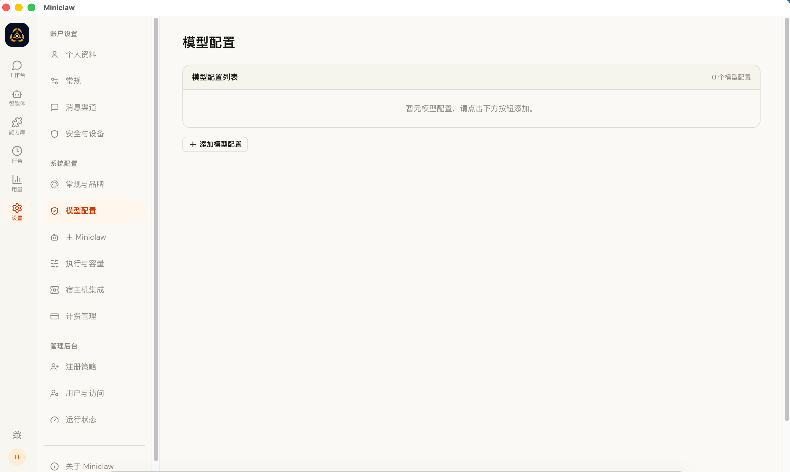

# Miniclaw

<p align="center">
  
</p>

<p align="center">
  <strong>自托管、Pi Agent 驱动的多渠道智能体工作台</strong><br />
  把 Agent、工作区、记忆、工具、渠道与自动化任务组织在同一个可控的运行环境中。
</p>

<p align="center">
  <a href="https://github.com/helsome/miniclaw">GitHub</a> ·
  <a href="docs/API.md">API</a> ·
  <a href="docs/ACL-MATRIX.md">权限模型</a> ·
  <a href="SECURITY.md">安全策略</a>
</p>

> 一句话：聊天界面让你向 Agent 提问；Miniclaw 让 Agent 拥有长期运行的工作区、可审计的能力边界，以及能够被 Web、桌面端和消息渠道共同使用的运行时。

## 产品定位

Miniclaw 是一个面向个人与团队的自托管 AI Agent 工作台，采用智能体优先工作模型。它不是一个只保存聊天记录的对话框，而是把以下对象放在同一个产品模型中：

- Agent 身份、模型策略与能力配置。
- Workspace 文件、执行环境、权限和渠道绑定。
- 持久化 Session、流式输出、取消、恢复和后台运行。
- Workspace 级 Memory、Skills、MCP、Plugins 与 Subagents。
- Web、Electron Desktop、飞书、Telegram、QQ、钉钉、微信、Discord、WhatsApp 等入口。
- Cron、间隔和一次性任务，以及任务运行历史、通知与恢复。

Miniclaw 采用本地优先和显式集成的思路：数据库、工作区元数据、会话状态和配置由自己的服务管理；模型、消息渠道、Docker 与外部工具都作为可配置边界接入。

## 界面与体验

工作台围绕 `Agent → Workspace → Runtime Session` 组织信息。左侧导航提供工作台、智能体、能力库、任务、用量、账单和设置入口；进入工作台后，可以在同一个界面中切换 Agent、Workspace 和对话上下文。

下面是当前桌面端工作台的实际界面：

<p align="center">
  
</p>

<p align="center">
  <em>工作台：在同一个窗口中管理 Agent、Workspace、Session 与对话。</em>
</p>

<p align="center">
  
  
</p>

<p align="center">
  <em>能力库与模型配置：把 Skills、MCP、Plugins 和 Provider 配置放在清晰的管理边界内。</em>
</p>

新的 Miniclaw 图标同时用于 Web/PWA、Electron 窗口和安装包资源：

<p align="center">
  
</p>

## 核心功能

### Agent 与 Workspace

- 用 Agent Profile 保存身份、模型、思考级别、Skills、MCP 与执行策略。
- 每个 Workspace 拥有独立的文件、Session、Memory、渠道绑定和执行边界。
- Home Workspace 与自定义 Agent 分层管理，支持创建、重命名、重建、清空和删除。
- 支持 Host 与 Docker 两种执行方式；需要隔离的任务可以在 Agent Runner 容器中运行。

### Pi Agent Runtime

- 基于 Pi Agent Runtime 提供 prompt、流式输出、工具调用、Session 持久化与恢复。
- 支持 abort、follow-up、原生 compaction 和持久化 JSONL Session。
- 复用 Miniclaw 已有的 MCP capability handler，并映射为稳定的 `mcp__miniclaw__*` 工具。
- Subagents 通过 Pi extension 与显式的 spawn/stop 生命周期桥接。
- Runtime 不会静默假装拥有缺失能力；尚未接入 Pi 的 Web Search/Web Fetch 能力会保持明确不可用。

### Memory 与上下文

- Memory 按 Workspace 隔离，不在不同工作区之间隐式共享。
- 支持事实、偏好、决策和经验等知识类型，以及搜索、编辑、忘记和版本历史。
- 写入使用 revision 与 compare-and-set，避免并发编辑覆盖彼此的修改。
- 每条 Memory 可记录来源 Session、来源类型、观察时间和变更历史，便于回溯 provenance。
- Runtime 只注入当前 Workspace 允许使用的记忆，不把平台身份约束当作普通用户记忆。

### Skills、MCP 与 Plugins

- 内置、宿主机、项目、用户、Workspace 和 Plugin 层级的 Skills 统一解析。
- 能力库集中展示 Skills、MCP 与 Plugins 的可用状态、依赖和能力预览。
- Plugin Catalog 支持扫描、导入、版本快照和用户启用配置。
- Agent 运行前会计算有效能力 Manifest，并把 Skills、MCP、Memory、Workspace 与渠道上下文按策略注入。
- 路径穿越、符号链接逃逸、越权 Workspace 与未授权 capability 会在边界层拒绝。

### 渠道与自动化

- 支持将消息渠道绑定到指定 Workspace 或 Session，并按用户、群聊、话题和 owner 规则进行 ACL 判断。
- 支持飞书、Telegram、QQ、钉钉、微信、Discord、WhatsApp 等消息入口。
- Scheduler 支持 Cron、固定间隔和一次性任务，提供立即运行、暂停、取消、运行历史和结果投递。
- 后台任务、Subagent 和渠道回复都沿用同一套 Workspace、Session、owner 与权限上下文。

### Electron Desktop

- Electron 只是 Desktop Shell，复用现有 Web Client，不在 Renderer 中承载数据库、文件系统、凭证、Docker 或 shell/process 权限。
- Main Process 负责窗口生命周期、外部链接、菜单和受限 IPC；Preload 只暴露白名单 API。
- 默认提供 macOS arm64 打包配置，并保留 Windows、Linux 目标配置。
- 同一套 Renderer 可以连接本地 Backend，也可以通过 `MINICLAW_SERVER_URL` 连接远程 Miniclaw 服务。

## 工作原理

```text
Web Client / Electron Desktop / Message Channels
                         │ HTTP + WebSocket / Channel Adapters
                         ▼
                Miniclaw Backend
        Auth · API · Queue · Scheduler · ACL
                         │
        ┌────────────────┼─────────────────┐
        ▼                ▼                 ▼
   Workspace         Capability         Channel
   Session           Registry            Binding
   Memory            Skills/MCP          Delivery
                         │
                         ▼
                 Pi Agent Runner
                   Host / Docker
                         │
                         ▼
                Pi Agent Runtime
          Tools · Extensions · Subagents
```

核心边界保持清晰：Backend 负责认证、持久化、队列、调度、渠道和授权；Pi Runner 负责 Agent 执行；Workspace 决定文件与运行边界；Electron Renderer 只负责界面和受限的桌面桥接。

## 快速开始

### 环境要求

- Node.js 20 或更高版本
- npm
- GNU Make
- 如果使用容器执行模式，需要 Docker

### 启动 Backend 与 Web Client

```bash
git clone https://github.com/helsome/miniclaw.git
cd miniclaw

npm install
npm --prefix web install
npm --prefix container/agent-runner install

# 首次安装或依赖更新后构建 Backend、Web 与 Agent Runner
npm run build:all

# 启动生产式本地服务
npm start
```

默认地址：<http://127.0.0.1:3000>

开发模式可以直接启动 Backend 和 Vite Web Client：

```bash
npm run dev:all
```

首次进入时完成管理员初始化和 Provider 配置即可。Provider/渠道接入步骤现在可以选择“稍后设置”，跳过后仍可进入工作台，之后在设置中补齐模型和渠道配置。

Agent 容器镜像默认使用 `helsome/miniclaw-agent:latest`，可以通过 `MINICLAW_CONTAINER_IMAGE` 或 `CONTAINER_IMAGE` 覆盖。

### 启动 Electron Desktop

先启动 Backend 与 Vite：

```bash
npm run dev:all
```

再在另一个终端启动桌面端：

```bash
MINICLAW_RENDERER_URL=http://127.0.0.1:5173 npm run desktop:dev
```

如果直接使用 Backend 提供的构建后页面，可以省略 `MINICLAW_RENDERER_URL`：

```bash
npm run desktop:dev
```

连接远程 Backend 时：

```bash
MINICLAW_SERVER_URL=https://your-miniclaw.example.com npm run desktop:dev
```

打包命令：

```bash
# 生成未安装目录，适合本地冒烟验证
npm run desktop:package:dir

# 生成当前平台的安装包
npm run desktop:package
```

打包配置位于 [`electron/electron-builder.yml`](electron/electron-builder.yml)，图标资源位于 [`electron/assets`](electron/assets)。正式发布前请为目标平台配置签名与公证。

## 常用命令

| 命令                | 说明                                             |
| ------------------- | ------------------------------------------------ |
| `npm run dev:all`   | 启动 Backend 与 Vite Web Client                  |
| `npm run build:all` | 构建 Backend、Web Client 与 Agent Runner         |
| `npm run typecheck` | 检查 Backend TypeScript                          |
| `make typecheck`    | 执行 Backend、Web、Agent Runner 的完整类型与文档 |
